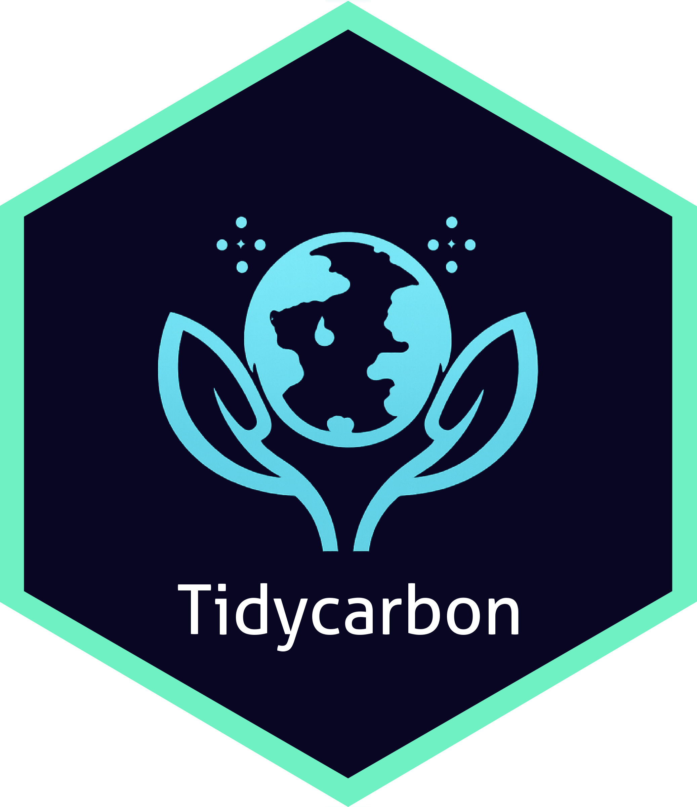

<!-- # tidycarbon  -->

<!-- badges: start -->

<!--[](https://github.com/seankellyhp/Tidycarbon/actions) -->

<!--[](https://lifecycle.r-lib.org/articles/stages.html#experimental) -->
<!-- badges: end -->

`tidycarbon` provides a minimal tidy R interface to [CodeCarbon](https://mlco2.github.io/codecarbon/), a Python library for tracking the carbon emissions and energy consumption (CPU, GPU, RAM) of computational processes. With just a few lines of code, measure the sustainability impact of your R functions, scripts, or pipelines, including detailed metrics like emissions, water use, hardware specs, and location-based carbon equivalency estimates.

## Motivations
The motivation behind `tidycarbon` is to help R users, including computational researchers and practitioners: 
1. Reduce the environmental impact of big data analyses and AI systems that disproportionately affect disadvantaged people and communities, particularly in the Global South, [learn more](https://osf.io/preprints/socarxiv/vwb5h_v1).  
2. Reduce reliance of academic researchers on third-party analytics services such as ChatGPT or Google Cloud in favor of local/private hardware and open source tools such as [Ollama](https://jbgruber.github.io/rollama/), [learn more](https://www.nature.com/articles/d41586-023-01295-4). 
3. Align with the UN Sustainable Development Goals, namely [SDG 12 (Responsible Consumption and Production)](https://sdgs.un.org/goals/goal12#targets_and_indicators) and [SDG 13 (Climate Action)](https://sdgs.un.org/goals/goal13#overview). 
4. Align with the EU AI Act (private-sector) responsibility of "reporting and documentation processes to improve AI systems resource performance, such as reducing the high-risk AI system’s consumption of energy and of other resources during its lifecycle" [(Article 40)](https://artificialintelligenceact.eu/article/40/).

This package is very much in-development and will change often. 

## Installation

Install the development version from GitHub:

```r
# install.packages("remotes")
remotes::install_github("seankellyhp/Tidycarbon")
```

`tidycarbon` relies on [reticulate](https://rstudio.github.io/reticulate/) to interface with CodeCarbon. Installation via reticulate relies on the Python uv package, and should happen automatically without any additional manual effort from you (recommended). If you prefer a manual installation (using conda or venv), refer to the reticulate docs. 

## Quickstart

### Global Tracking (wrap any R code)
Think of this like time benchmarking packages such as tictok or microbenchmark. You start the tracker and you stop the tracker. Everything in between remains the same. `tidycarbon` will measure your machine on the backend.

```r
library(tidycarbon)

# First, initiate the carbon tracking engine. 
tracker <- carbon_init(project_name = "Fridays for Future")

# Second, start the tracker.
tracker_start(tracker)

# Next, write your R code here (supports tidyverse, parallel, topicmodels, quanteda, ...everything)
library(dplyr)
iris %>%
  select(Sepal.Length) %>%
  pull() %>%
  sum()

# Finally, stop the tracker. 
tracker_stop(tracker)
```

Emissions data is automatically logged to `emissions.csv` in the root project folder. Unless otherwise specified, emissions results will always be appended to this file. 

### Task Tracking (functions with tibble output)
This is a little different from a time benchmarking package. As one of the main use-cases of an emissions tracker is to measure the carbon footprint of heavy computational processes such as machine learning or language models, the carbon_track functions track the emissions for a specific function or list of functions.    

```r
library(tidycarbon)

# First, initiate the carbon tracking engine. 
tracker <- carbon_init(project_name = "Fridays for Future")

# Next, define your function(s)
square <- function(x) x^2

# Then, track a single function
carbon_track(square, x = 42, tracker = tracker)

# Or, track multiple functions
tasks <- list(
  list(fun = square, args = list(x = 2)),
  list(fun = square, args = list(x = 3))
)
carbon_track_all(tasks, tracker)

# Finally, stop the tracker. 
tracker_stop(tracker)
```

Returns a tidy tibble with task id, function results, metadata, emissions, energy, hardware, and geo data:

```
# A tibble: 1 × 35
  project_name run_id ... emissions_total cpu_power ...
  <chr>        <chr>  ...           <dbl>      <dbl> ...
```

### Provider Tracking (hosted LLMs)
CodeCarbon measures the electricity *your machine* draws. When your R code calls a hosted language model (ChatGPT, Claude, Gemini, ...), the model runs in the provider's datacenter, which CodeCarbon cannot see. `tidycarbon` estimates that provider-side impact with [EcoLogits](https://ecologits.ai), from the tokens each request was billed for.

Create a remote tracker around an [ellmer](https://ellmer.tidyverse.org) chat and use it exactly like a CodeCarbon tracker. The functions stay the same; only the target changes:

```r
library(tidycarbon)

chat <- ellmer::chat_openai(model = "gpt-4o-mini")
tracker <- carbon_init_remote(chat, project_name = "Fridays for Future")

summarise_text <- function(text) chat$chat(paste("Summarise:", text))

res <- carbon_track(summarise_text, text = my_text, tracker = tracker)
res              # one row: result, energy / CO2e / water as lower and upper bounds
res$calls[[1]]   # one row per request: tokens, model, whether it was modelled
```

`carbon_track_all()`, `carbon_run()`, `carbon_step()` (with `carbon_collect()`) and `tracker_start()` / `tracker_stop()` accept the same tracker. To measure your machine and the provider over the same code, open one tracker globally and pass the other:

```r
local <- carbon_init(project_name = "Fridays for Future")

tracker_start(tracker)
res_local <- carbon_track(summarise_text, text = my_text, tracker = local)
res_provider <- tracker_stop(tracker)
```

The tracker sees the requests made through the chat it was given. For other clients (rollama, httr2, ...), build the requests table yourself with `carbon_calls()` and estimate it with `carbon_provider()`. To measure a Claude Code session, read its transcript:

```r
calls <- calls_from_transcript("~/.claude/projects/<project>/<session-id>.jsonl")

carbon_tokens(calls)                                   # sent, received, cache hit rate
carbon_provider(calls) |> carbon_provider_summary()    # summed lower / upper bounds
carbon_provider(calls) |> carbon_provider_summary(by = "model")
```

Here is an example of one Claude Code session (34 requests, 2.6M tokens sent, 41k received):

| | lower | upper |
|---|---|---|
| Energy | 121.0 Wh | 239.9 Wh |
| CO2e | 48.4 g | 94.1 g |
| Water | 0.39 L | 0.96 L |

How to read these numbers:

- **They are estimates, not measurements.** EcoLogits models inference from each model's size and output length; nothing is measured at the provider.
- **Only output tokens count.** Input and cached tokens do not enter the EcoLogits model, so a long prompt adds nothing to the estimate.
- **Figures are ranges** (`*_min` / `*_max`) whenever a provider does not publish its model's size, which is the usual case for closed models. `*_mean` is the midpoint of that range.
- **Only models EcoLogits knows are estimated.** The model name is looked up in the EcoLogits registry as is. One it has not registered, often a model newer than the installed release, is left out (`modelled = FALSE`, with the EcoLogits error code in `error`) rather than approximated.
- **Never add them to CodeCarbon's figures.** One is your machine, measured; the other is the provider's datacenter, modelled. Each tracker returns its own table for that reason.

EcoLogits is installed automatically through reticulate the first time a provider function is used.

## Key Functions

- `carbon_init()`: Create a CodeCarbon tracker (your machine).
- `carbon_init_remote()`: Create a remote tracker (hosted LLM provider; `engine = "ecologits"`).
- `tracker_start()` / `tracker_stop()`: Global run tracking.
- `carbon_track(fun, ..., tracker)`: Track single function.
- `carbon_track_all(tasks, tracker)`: Batch track list of tasks.
- `carbon_calls()`, `calls_from_ellmer()`, `calls_from_transcript()`: Collect billed LLM requests.
- `carbon_tokens()`: Token accounting (sent, received, cache hit rate).
- `carbon_provider()` / `carbon_provider_summary()`: Provider-side inference impacts with EcoLogits.
- `carbon_view()`: Starts a Shiny dashboard at localhost (in development)

## Examples

See `vignettes` for more examples (in development).

## Features & Notes

- **Rich metrics**: CO2e, energy (Wh), water (L), power draw, hardware/GPU details.
- **Tidy output**: Results + emissions in one tibble.
- **Visual Dashboard**: Results are viewed from a Shiny Dashboard (in development)
- **Hosted LLMs**: Token accounting and EcoLogits estimates of provider-side inference, kept separate from local measurements.
- **Modern reticulate**: Auto-imports `codecarbon` (and `ecologits` when needed).
- **Roadmap**: Tests, vignettes, website, pipe operator.

## Citation

Palicki, S., & Bravo, I. (2025). tidycarbon: Tidy R Wrapper for the CodeCarbon Emissions Tracker. https://github.com/seankellyhp/Tidycarbon

<!-- ## Contributing

Contributions welcome! See [CONTRIBUTING.md](https://github.com/seankellyhp/Tidycarbon/blob/main/CONTRIBUTING.md) (create if missing). --!> 
