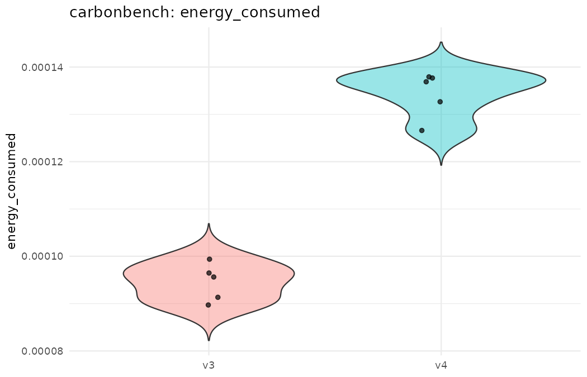

```{r, include = FALSE}
knitr::opts_chunk$set(collapse = TRUE, comment = "#>", eval = FALSE)
```

`vignette("local-tracking")` tracks a script and single functions. This guide
covers larger units of work:

- `carbon_run()` tracks **a whole pipeline** written as one expression, and
  hands back its result with a one-row log.
- `carbon_step()` tracks **each step** of a piped pipeline, so you can see
  where the energy goes.
- `carbon_bench()` **benchmarks expressions** against each other over
  repeated runs, the way `microbenchmark::microbenchmark()` does for time.

The example fits a topic model to 6,000 Guardian articles with quanteda and
topicmodels, then compares tokenization in quanteda 3 and quanteda 4. The
output shown is from a real run.

## Setup

```{r}
library(tidycarbon)
library(dplyr)
library(ggplot2)
library(quanteda)
library(quanteda.corpora)   # remotes::install_github("quanteda/quanteda.corpora")
library(topicmodels)

guardian <- download("data_corpus_guardian")

ndoc(guardian)
#> [1] 6000
```

## Create a tracker that logs to a folder

`carbon_init()` creates a CodeCarbon tracker and registers it for the
session. Give it an `output_dir` to write the log where you tell it, instead
of the working directory. The folder has to exist:

```{r}
out_dir <- file.path(tempdir(), "tidycarbon_topicmodels")
dir.create(out_dir, showWarnings = FALSE, recursive = TRUE)

carbon_init(
  project_name = "topicmodels_guardian",
  output_dir   = out_dir
)
```

Use a folder of your own rather than `tempdir()` if you want to keep the log
after the session ends.

## Track a whole pipeline

Wrap the pipeline in `carbon_run()`. The braces can hold any number of
statements; the value of the last one is the result:

```{r}
run <- carbon_run({
  dtm <- tokens(guardian, remove_punct = TRUE, remove_symbols = TRUE,
                remove_numbers = TRUE, remove_url = TRUE) |>
    tokens_tolower() |>
    tokens_remove(stopwords("en")) |>
    tokens_wordstem() |>
    dfm() |>
    dfm_trim(min_termfreq = 10, min_docfreq = 5) |>
    convert(to = "topicmodels")

  LDA(dtm, k = 20, method = "Gibbs",
      control = list(seed = 42, iter = 100, burnin = 10))
}, label = "guardian topic model")
```

`run` is a list of two things. `run$result` is what the expression returned,
here the fitted model:

```{r}
terms(run$result, 5)[, 1:4]
#>      Topic 1      Topic 2      Topic 3   Topic 4
#> [1,] "govern"     "trump"      "compani" "one"
#> [2,] "said"       "state"      "busi"    "year"
#> [3,] "minist"     "clinton"    "bank"    "mani"
#> [4,] "australia"  "republican" "said"    "church"
#> [5,] "australian" "campaign"   "year"    "first"
```

`run$log` is one row describing the window:

```{r}
run$log |>
  select(label, wall_time_sec, energy_consumed, emissions_total)
#> # A tibble: 1 × 4
#>   label                wall_time_sec energy_consumed emissions_total
#>   <chr>                        <dbl>           <dbl>           <dbl>
#> 1 guardian topic model          20.0        0.000554        0.000211
```

`wall_time_sec` is seconds, `energy_consumed` kWh and `emissions_total`
kgCO2eq. The energy is split by component:

```{r}
run$log |>
  transmute(
    cpu_wh   = cpu_energy * 1000,
    ram_wh   = ram_energy * 1000,
    gpu_wh   = gpu_energy * 1000,
    total_wh = energy_consumed * 1000
  )
#> # A tibble: 1 × 4
#>   cpu_wh ram_wh gpu_wh total_wh
#>    <dbl>  <dbl>  <dbl>    <dbl>
#> 1  0.292  0.111  0.150    0.554
```

Nothing in this pipeline uses the GPU. The 0.150 Wh is what an idle graphics
card drew for twenty seconds: the tracker measures the machine, not the R
process.

## Find the expensive part

Which costs more, preparing the text or fitting the model? `carbon_step()`
answers that by tracking one function call at a time. Put it between the
pipes: the data comes in on the left, then the function, then its arguments.
The session tracker serves every step:

```{r}
model <- guardian |>
  carbon_step(tokens, remove_punct = TRUE, remove_symbols = TRUE,
              remove_numbers = TRUE, remove_url = TRUE, label = "tokens") |>
  carbon_step(tokens_tolower, label = "lowercase") |>
  carbon_step(tokens_remove, pattern = stopwords("en"),
              label = "remove stopwords") |>
  carbon_step(tokens_wordstem, label = "stem") |>
  carbon_step(dfm, label = "dfm") |>
  carbon_step(dfm_trim, min_termfreq = 10, min_docfreq = 5, label = "trim") |>
  carbon_step(convert, to = "topicmodels", label = "convert") |>
  carbon_step(LDA, k = 20, method = "Gibbs",
              control = list(seed = 42, iter = 100, burnin = 10),
              label = "LDA")
```

A step can also be written as a call, with the data left out of it:
`carbon_step(tokens_ngrams(n = 1:3))`.

`model` is the fitted topic model, exactly as the plain pipeline would return
it. The measurements travel along with it, and `carbon_collect()` pulls them
out, one row per step:

```{r}
steps <- carbon_collect(model)

steps |>
  transmute(label, wall_time_sec,
            energy_wh = energy_consumed * 1000,
            share     = energy_consumed / sum(energy_consumed))
#> # A tibble: 8 × 4
#>   label            wall_time_sec energy_wh   share
#>   <chr>                    <dbl>     <dbl>   <dbl>
#> 1 tokens                   4.44    0.175   0.293
#> 2 lowercase                0.233   0.00608 0.0102
#> 3 remove stopwords         0.152   0.00491 0.00824
#> 4 stem                     0.114   0.00293 0.00491
#> 5 dfm                      0.145   0.00446 0.00749
#> 6 trim                     0.102   0.00276 0.00462
#> 7 convert                  0.603   0.0155  0.0261
#> 8 LDA                     14.0     0.385   0.645
```

The Gibbs sampler is about two thirds of the energy and tokenizing most of
the rest; everything in between is a rounding error. The number of topics and
iterations is where a saving would come from.

## Read the full log

`carbon_run()` and `carbon_step()` return their measurements directly. Each
one is also appended to `emissions_r.csv` in `output_dir`, and
`carbon_read()` returns that file as a tibble, one row per run and step:

```{r}
list.files(out_dir)
#> [1] "emissions_r.csv"

carbon_read(out_dir) |>
  select(label, wall_time_sec, energy_consumed, emissions_total)
#> # A tibble: 9 × 4
#>   label                wall_time_sec energy_consumed emissions_total
#>   <chr>                        <dbl>           <dbl>           <dbl>
#> 1 guardian topic model        20.0        0.000554        0.000211
#> 2 tokens                       4.44       0.000175        0.0000666
#> 3 lowercase                    0.233      0.00000608      0.00000232
#> 4 remove stopwords             0.152      0.00000491      0.00000187
#> 5 stem                         0.114      0.00000293      0.00000112
#> 6 dfm                          0.145      0.00000446      0.00000170
#> 7 trim                         0.102      0.00000276      0.00000105
#> 8 convert                      0.603      0.0000155       0.00000592
#> 9 LDA                         14.0        0.000385        0.000147
```

The file is a record, not a dependency: nothing reads it back, so deleting
it loses the history but changes no result.

## Benchmark two expressions

`carbon_bench()` takes two or more named expressions and runs each `times`
times, in random order, after one untracked warm-up run of each. It creates
and stops its own tracker, and leaves the session tracker alone. Here it compares the tokenizer in quanteda 3
with the one in quanteda 4 on the same articles split into sentences:

```{r}
corp <- corpus_reshape(guardian)

ndoc(corp)
#> [1] 202011

bench <- carbon_bench(
  v3 = quanteda3::tokens(corp, remove_punct = TRUE, remove_numbers = TRUE,
                         remove_symbols = TRUE),
  v4 = tokens(corp, remove_punct = TRUE, remove_numbers = TRUE,
              remove_symbols = TRUE),
  times = 5,
  project_name = "quanteda_bench_carbon"
)
```

The expressions are captured unevaluated, so pipes work inside them. The
result has one row per run:

```{r}
bench |> select(task_id, expr, iter, duration, energy_consumed, emissions_total)
#> # A tibble: 10 × 6
#>    task_id expr   iter duration energy_consumed emissions_total
#>    <chr>   <chr> <int>    <dbl>           <dbl>           <dbl>
#>  1 v4_2    v4        2     4.61       0.000127        0.0000482
#>  2 v3_5    v3        5     3.33       0.0000897       0.0000342
#>  3 v3_2    v3        2     3.63       0.0000965       0.0000367
#>  4 v3_4    v3        4     3.59       0.0000956       0.0000364
#>  5 v4_3    v4        3     5.06       0.000138        0.0000524
#>  6 v3_1    v3        1     3.66       0.0000994       0.0000379
#>  7 v3_3    v3        3     3.37       0.0000913       0.0000348
#>  8 v4_5    v4        5     5.04       0.000138        0.0000525
#>  9 v4_4    v4        4     4.79       0.000133        0.0000505
#> 10 v4_1    v4        1     4.80       0.000137        0.0000521
```

It is an ordinary tibble, so summarise it with dplyr:

```{r}
bench |>
  group_by(expr) |>
  summarise(
    runs      = n(),
    duration  = median(duration),
    energy_wh = median(energy_consumed) * 1000,
    co2e_mg   = median(emissions_total) * 1e6
  )
#> # A tibble: 2 × 5
#>   expr   runs duration energy_wh co2e_mg
#>   <chr> <int>    <dbl>     <dbl>   <dbl>
#> 1 v3        5     3.59    0.0956    36.4
#> 2 v4        5     4.80    0.137     52.1
```

On this machine and corpus, tokenizing with quanteda 4 takes about a third
longer and about 40% more energy than quanteda 3.

## Plot the benchmark

`autoplot()` draws the runs as points over a violin. `metric` is one of
`"duration"`, `"emissions_total"` or `"energy_consumed"`:

```{r}
autoplot(bench, metric = "energy_consumed")
```

```{r, echo = FALSE, eval = TRUE, out.width = "80%"}

```

The return value is a ggplot, so add scales and labels as usual:

```{r}
autoplot(bench, metric = "energy_consumed") +
  scale_y_continuous(labels = \(x) x * 1000) +
  labs(y = "Energy per run (Wh)")
```

## How to read the numbers

- **One tracker is enough.** Every `carbon_run()` and `carbon_step()` is
  measured on its own, however many share a tracker.
- **The window is the whole machine.** Idle components and other programs
  are included, which is why a CPU-only pipeline shows GPU energy.
- **Short runs are noisy.** `carbon_bench()` samples power every 0.01 seconds
  to resolve them, and repeats each expression; raise `times` before trusting
  a small difference.
- **Results are specific to the hardware.** The benchmark above is one CPU
  and one corpus. Rerun it where your code actually runs.

## Where next

- To track individual functions and compare them as tasks, see
  `vignette("local-tracking")`.
- `carbon_run()` also accepts a remote tracker for pipelines that call a
  hosted language model; see `vignette("remote-tracking")`.
